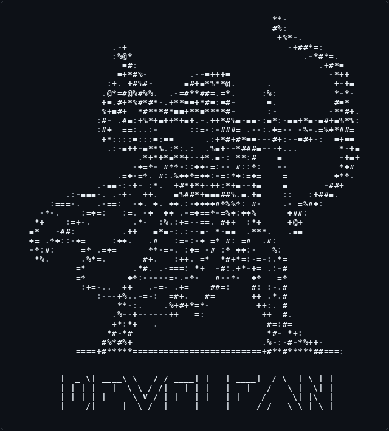

  

 

 

 

<!-- ───────────── TECH STACK ───────────── -->
<h2 align="center">⚡ Tech Stack</h2>

  

 

<!-- ───────────── CONNECT ───────────── -->
<h2 align="center">🤝 Let's Connect</h2>

  
  
  

 

